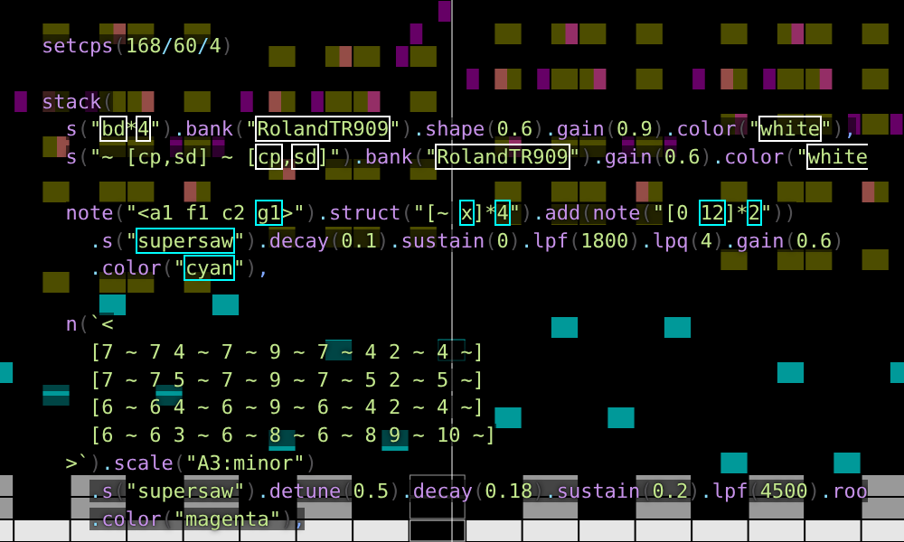

# Algorave Kit for VS Code

Live code **Strudel** and **TidalCycles** from VS Code, with your kit's patterns in the sidebar,
visuals beside the code and a mode for playing out.



## What it does

| | Strudel (`.strudel`, `.str`) | Tidal (`.tidal`) |
| --- | --- | --- |
| `Ctrl+Enter` (`Cmd+Enter`) | Play / update the whole file | Run the block under the cursor (or the selection) |
| `Shift+Enter` | Same as Ctrl+Enter | Run the current line |
| `Ctrl+.` (`Cmd+.`) | Hush everything | Hush everything |
| `Ctrl+Alt+H` | Hush from anywhere | Hush from anywhere |
| `Ctrl+Alt+P` | Performance mode on / off | Performance mode on / off |
| `Ctrl+Alt+V` | Projector view on / off | n/a |

**Strudel** runs in your web browser: the first `Ctrl+Enter` opens a tab that VS Code then drives,
so you keep typing in VS Code and the sound and visuals come from the browser. (Set
`algorave.strudel.engine` to `panel` to run it in a VS Code panel instead. That only works if your
VS Code build gives webviews WebGL and audio; the Snap and Flatpak builds often don't.) It uses the same `@strudel/repl@1.3.0` as
the kit's `index.html`, so everything in `patterns.js` works: samples, `.pianoroll()`, `.punchcard()`,
`.scope()`, `.spiral()`, `_pianoroll()` inline widgets, and Hydra with `initHydra()` / `H()`.
While it plays, the mini-notation steps that are sounding get outlined in *your* editor, and they
stay in place as you type.

**Tidal** starts GHCi with your kit's `tidal/BootTidal.hs` the first time you evaluate (or from
*Algorave: Boot Tidal*). Output goes to the **Tidal** output panel, which pops up on errors without
taking focus. If you turn on `algorave.tidal.startSuperDirt`, it also launches `sclang` with
`tidal/superdirt_startup.scd`.

**Kit sidebar** (the wave icon in the activity bar) lists the Strudel patterns from `patterns.js`
and the numbered sections of each `.tidal` set. Click to open, ▶ to open and play. It reloads when
you edit `patterns.js`. *Algorave: Open Pattern from Kit…* does the same from the command palette.

**Performance mode** sets Strudel and Tidal files to a big font (22 by default), enters Zen Mode and
opens the visuals. Turning it off puts your font settings back.

**Projector view** shows the code that's playing over the visuals, with the steps lighting up, like
the kit's ⛶ Projector button. Drag the browser tab onto the projector screen and press **F** (or the
⛶ Fullscreen button) for fullscreen, and keep VS Code on the laptop.

## First run

1. Install the prebuilt package in this folder: `code --install-extension vscode-extension/algorave-kit-0.2.0.vsix`
   (or build it yourself, see *Develop*)
2. Open your `live_coding` folder. The sidebar finds `patterns.js` and `tidal/` by itself
   (or set `algorave.kitPath`).
3. Open a pattern, press `Ctrl+Enter`. A browser tab opens: click it once (browsers only allow
   sound after a click), then go back to VS Code and carry on. Keep that tab open while you play;
   if you close it, the next `Ctrl+Enter` opens a new one.

You need internet for Strudel the first time a session loads samples, same as the web kit.

## Settings

| Setting | Default | |
| --- | --- | --- |
| `algorave.kitPath` | auto | Folder with `patterns.js` / `tidal/` |
| `algorave.strudel.engine` | `browser` | `browser` tab, or `panel` inside VS Code |
| `algorave.strudel.replUrl` | unpkg `@strudel/repl@1.3.0` | Pin the Strudel version |
| `algorave.strudel.highlight` | `true` | Outline playing steps in the editor |
| `algorave.strudel.openPatternIn` | `newTab` | Or `activeEditor` to swap the code in the current tab |
| `algorave.flash` | `true` | Flash code when it's evaluated |
| `algorave.tidal.ghciPath` / `ghciArgs` | `ghci` | e.g. `stack` + `["exec","--package","tidal","--","ghci"]` |
| `algorave.tidal.bootFile` | kit, then bundled | Your `BootTidal.hs` |
| `algorave.tidal.startSuperDirt` | `false` | Launch `sclang` too |
| `algorave.performance.fontSize` | `22` | |
| `algorave.performance.zenMode` | `true` | |
| `algorave.performance.showVisuals` | `true` | |
| `algorave.performance.projector` | `false` | Start the visuals in projector view |

Colours for the step outline and the flash are themeable: `algorave.activeStep`, `algorave.flashBackground`.

## Notes

- If you also have the official TidalCycles extension, both will want `Ctrl+Enter` in `.tidal`
  files. Disable one of them for the workspace.
- Booting Tidal and reading `patterns.js` run code from the workspace, so they need a trusted workspace.
  Strudel playback works anywhere.
- Strudel evaluates the whole file on each `Ctrl+Enter`, the same as the web REPL. Use `$:` or
  `stack()` for parts and comment lines out (`Ctrl+/`) to mute them.

## Develop

```bash
cd vscode-extension
npm install
npm test          # compiles + unit tests, including parsing this repo's patterns.js and .tidal sets
npm run package   # builds the .vsix
```

Press F5 in VS Code to run it in an Extension Development Host.
